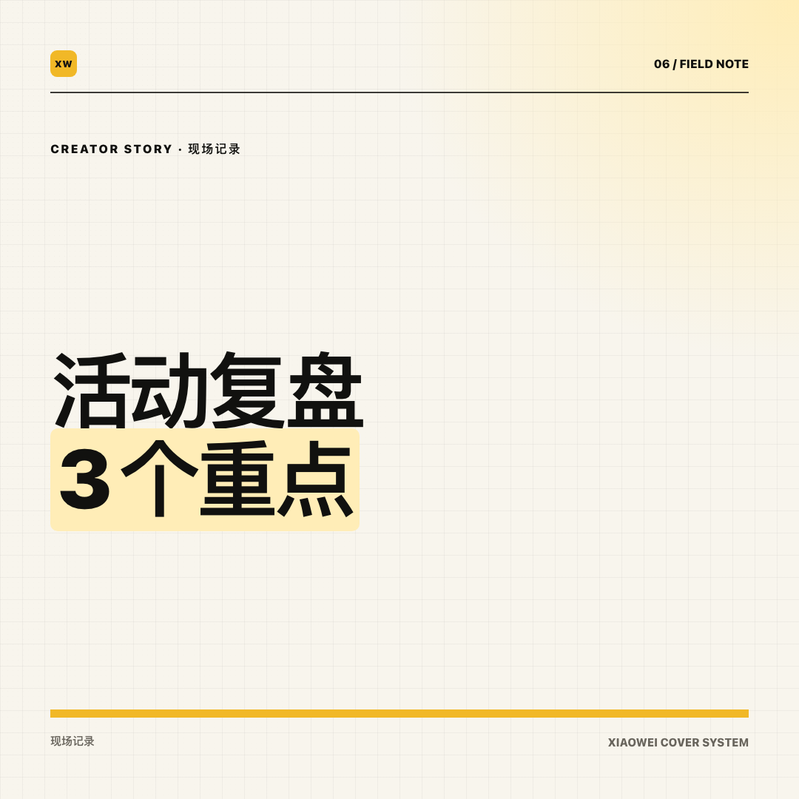
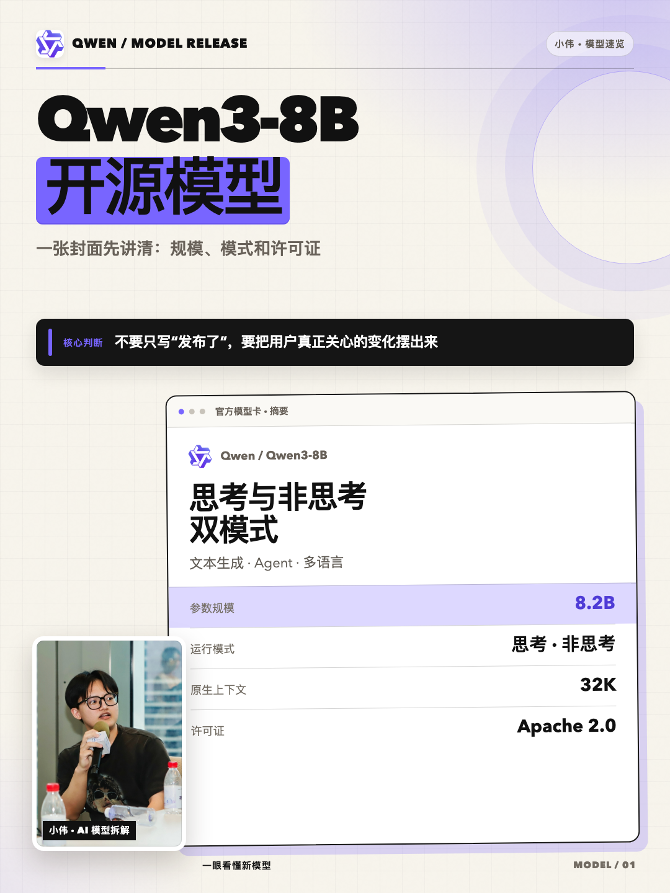
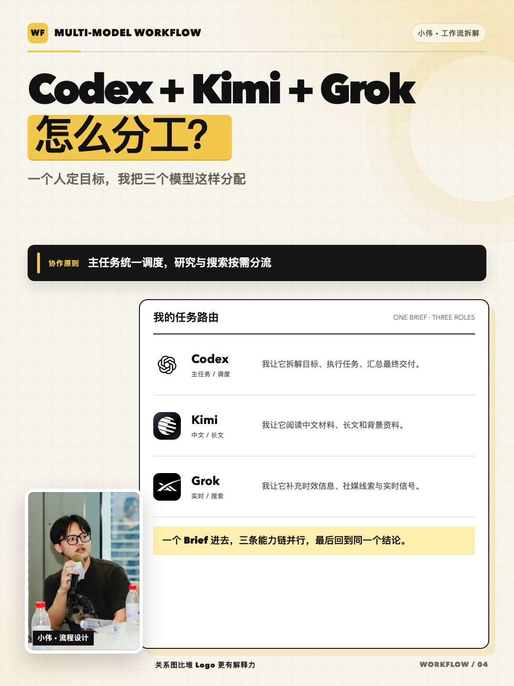

# Claim2Cover | Xiaowei AI Cover Evidence Chain

> Art-direction v2: read the source, plan the subject relationships and complete visual language, generate each requested ratio, then inspect actual images. A single article defaults to one direction. Explicit multi-style requests respect the requested count; matching-series mode is opt-in. Identity stays recognizable while scene and pose follow the topic.

Existing generated images are archived in the [Xiaozhi hardware case](docs/cases/xiaozhi-hardware-20261014/README.md): four tool originals, five historical exports and a comparison sheet. Ratio failures and padded exports are labelled explicitly; these are not v0.8 success samples.

## New workflow

Use [COVER_PLAN v2](references/cover-plan.md) to author content-derived concepts and all six visible dimensions. The compiler checks real asset files, count, mode and cross-item composition collisions before creating a new project:

```bash
node scripts/build-cover-plan.mjs authored-plan.json /path/to/new-project
node scripts/validate-cover-output.mjs /path/to/OUTPUT_REVIEW.json --out /path/to/report.json
```

The compiler does not call a model. The output validator reads actual image dimensions and verifies declared inspection records; it does not recognize faces or style from pixels. Padding, stretching and mechanical cropping fail the native-cover check. A target ratio or targetPixels field is not a verified tool capability.

Twelve candidate directions include independently authored workbench, blueprint, handbook and type-led concepts. Different style labels, seeds, colors or generation engines do not prove distinct aesthetics. See [art direction](references/art-direction.md) and [upstream research](references/upstream-research.md). Source identity photos and relevant product/UI assets are inspected and role-labelled before generation.

Historical HTML/Claim-to-Pixel paths and examples below remain available for compatible tasks; they do not certify revised image-generation quality. “Copy plus platform covers” does not implicitly request five design alternatives.

## Maintainer evidence and reusable workflow

See [two historical maintainer tasks](docs/cases/README.md), the [workflow and maintenance plan](docs/maintainer-workflow.md), and the [Codex OSS application dossier](docs/oss/README.md). The cases include six unchanged historical PNGs, curated editable HTML, source records, and a checksum manifest. They demonstrate reuse by the maintainer, not third-party adoption. The fixed contract demo remains explicitly distinct from these tasks. [Copy-ready application text](docs/oss/application.md) is available in English and Chinese.

`npm run verify:cases` checks the curated package; `npm run test:cases` also re-renders both cases and exercises five failure checks. These run within `npm test`, alongside form text length validation.

## Claim-to-Pixel release contract

For auditable public work, the Agent classifies `fact / judgment / unknown` and authors separate 3:4, 21:9, and 1:1 briefs. The local CLI then deterministically validates sources, risky title tokens, asset rights, copy limits, measured DOM safe areas, and Git state before it renders exact-size PNGs.

```bash
node scripts/claim-to-pixel.mjs validate contest/demo/claim-to-pixel.invalid.json
node scripts/claim-to-pixel.mjs build contest/demo/claim-to-pixel.json /tmp/claim2cover-build
npm run demo:claim2cover -- /tmp/claim2cover-demo
```

The intentional “10×” fixture fails. The corrected fixture passes 8/8 content gates but stays `PENDING HUMAN SIGN-OFF`; only a named reviewer may sign it. Each approval is bound to the SHA-256 of the full non-signoff payload, so post-review edits fail closed, and release additionally requires a clean commit. The stable fixture is explicitly `liveAiClaimed:false` with its prompt provenance retained; it is not presented as a live model call.

## One sentence is enough

```text
$generate-xiaowei-covers

Turn this official release into WeChat and Xiaohongshu covers.
Verify the facts first. Keep the creator visibly present on every requested ratio,
vary the pose and position by topic, and author each surface separately.
```

## What the Skill produces

| File | Purpose |
| --- | --- |
| `COVER_PLAN.json` | Complete art directions, exact requested count and independent surface compositions |
| `prompts/*.md` | Full generation prompts with concrete visible dimensions and exact copy |
| `generation.json` | Planned calls followed by actual tool/output records |
| `OUTPUT_REVIEW.json` / `review-report.json` | Observed image checks and deterministic validation |
| `covers/*.png` | Inspected original cover images |
| `FACTS.md` / `assets/SOURCES.md` | Copy evidence and source/rights records |

Historical COVER_PROMPT and HTML fixtures below remain compatible.

## Six content routes

| Route | Use it for | The cover must answer | Primary evidence |
|---|---|---|---|
| `model_release` | releases, open source, versions, pricing, capability changes | What changed, and who should care? | official release, model card, repository |
| `tool_tutorial` | setup, deployment, integration, troubleshooting | What can the reader complete? | real UI, terminal output, before/after |
| `model_comparison` | multiple models on the same task | Where do they actually differ? | comparable test matrix |
| `workflow` | multi-model or multi-agent roles | Who does what, and how do they connect? | role map, process, execution record |
| `official_evidence` | release notes, papers, docs, announcements | What does the primary source really change? | original document and key passages |
| `field_recap` | events, talks, projects, hands-on retrospectives | What did the creator learn first-hand? | contextual photo and first-person conclusion |

Routes are content structures, not six color variants of one poster.

## Historical HTML: three surfaces, three compositions

| Surface | Production size | Rule |
|---|---:|---|
| Xiaohongshu portrait | `1080×1440` | title above; creator remains visible; position follows the topic |
| WeChat main cover | `2100×900` | creator, title and evidence are independently recomposed |
| WeChat square cover | `1080×1080` | separate 4–10-character title plus visible creator; never a mechanical crop |

WeChat jobs also export a `1944×620` paired review image.

The portrait is not a decorative sticker or optional module. Keep a recognizable creator on every requested ratio, while varying pose, action, position, scale, scene and crop by topic. Preserve hands, microphone, table and action context whenever they matter; recomposition is required instead of cropping one master image.

## Full-resolution examples

Click an image to inspect the original PNG.

<table>
  <tr>
    <td width="65%"><a href="docs/images/showcase/wechat/field-recap-2100x900.png"></a></td>
    <td width="35%"><a href="docs/images/showcase/wechat/field-recap-1080x1080.png"></a></td>
  </tr>
</table>

<table>
  <tr>
    <td width="33%"><a href="docs/images/showcase/xiaohongshu/01-model-release-1080x1440.png"></a></td>
    <td width="33%"><a href="docs/images/showcase/xiaohongshu/04-workflow-1080x1440.png"></a></td>
    <td width="33%"><a href="docs/images/showcase/xiaohongshu/06-field-recap-1080x1440.png"></a></td>
  </tr>
</table>

See all six routes in the [full-resolution gallery](docs/gallery.md).

## Install as a Codex Skill

Requirements: Codex, Node.js 20+, and either Google Chrome or Playwright. Video intake additionally requires `ffmpeg` and `ffprobe`.

```bash
mkdir -p ~/.codex/skills

git clone \
  https://github.com/siuserxiaowei/generate-xiaowei-covers.git \
  ~/.codex/skills/generate-xiaowei-covers
```

Restart the Codex session and invoke:

```text
$generate-xiaowei-covers
```

This repository is a Codex Skill, not a hosted web application. The Node scripts can be used directly, while research, routing, and prompt authoring are performed by Codex following `SKILL.md`.

## Reusable request template

```text
$generate-xiaowei-covers

Topic:
Primary sources:
Targets: Xiaohongshu / WeChat / both
One thing the reader should remember:
Must include:
Must avoid:
Portrait or product assets:
Primary evidence: model card / UI / comparison / workflow / document / photo

Verify first-party sources, then return:
1. route and rationale;
2. three title options;
3. a complete COVER_PROMPT.md;
4. independent compositions per surface;
5. PNG, editable HTML, FACTS.md, and SOURCES.md.
```

## Manual CLI

```bash
SKILL_DIR="$HOME/.codex/skills/generate-xiaowei-covers"

node "$SKILL_DIR/scripts/new-cover-project.mjs" ./my-cover vertical
node "$SKILL_DIR/scripts/new-cover-project.mjs" ./my-wechat-cover wechat

node "$SKILL_DIR/scripts/extract-video-frames.mjs" \
  ./demo.mp4 \
  ./my-cover/assets/evidence/video-frames

node "$SKILL_DIR/scripts/render-covers.mjs" \
  ./my-wechat-cover/cover.html \
  ./my-wechat-cover/output \
  --only release
```

A generated project contains:

```text
my-cover/
├── COVER_PROMPT.md
├── FACTS.md
├── cover.html
├── LICENSE
├── assets/
│   ├── portrait/
│   ├── brand/
│   ├── evidence/
│   └── SOURCES.md
└── output/
```

`--only` accepts route tokens, DOM IDs, `data-file` names, or a comma-separated combination.

## Evidence and rights

- Every visible factual claim must be recorded in `FACTS.md` with a primary URL, verification date, and supporting location.
- Every downloaded or supplied visual asset must be recorded in `assets/SOURCES.md`.
- The renderer checks pixels, not truth; publication remains a human gate.
- Bundled brand images are for demonstration and product identification. They do not imply endorsement or grant trademark rights.
- The repository owner has authorized the bundled portrait for this public project's examples. That does not grant others the right to reuse the portrait as their identity.

## What this is not

It is not:

- a Midjourney or Stable Diffusion replacement;
- a Canva-like drag-and-drop editor;
- a machine that invents benchmarks, rankings, quotes, or personal experience;
- a fixed poster that swaps text for every topic;
- a license clearinghouse for logos, screenshots, or portraits.

## Validation

```bash
npm test
```

The default test checks required Skill files, frontmatter, local template assets, six vertical export nodes, eighteen WeChat export nodes, JavaScript syntax, and real project creation. It renders `1080×1440`, `2100×900`, `1080×1080`, and `1944×620` outputs and verifies their PNG dimensions. Marked title regions that overflow their safe area are rejected instead of silently clipped. Thumbnail readability still receives a final human visual review.

Set `COVER_RENDERER=playwright` or `COVER_RENDERER=chrome` to verify one rendering backend explicitly. The default `auto` mode prefers Playwright and falls back to local Chrome.

## License, independent implementation, and visual inspiration

The content routes, cover-prompt system, portrait rules, current templates, and renderer are independently designed for this project.

Early visual exploration was inspired by the Swiss social-card idea in [`op7418/guizang-social-card-skill`](https://github.com/op7418/guizang-social-card-skill). The current public template uses an independent code implementation. Thank you to that project for the visual inspiration.

Code, documentation, and templates are released under [GNU AGPL-3.0](LICENSE). Portraits, third-party marks, organization avatars, and external screenshots are not relicensed by it. See [NOTICE.md](NOTICE.md) and [assets/SOURCES.md](assets/SOURCES.md).

## Current limitations

- This is a Skill plus an HTML/CSS rendering core, not a hosted editor.
- Fact verification, brand usage, and final publication remain human gates.
- There is no unified `cover.json` visual form yet.
- Video preprocessing uses temporal sampling followed by Agent review; local sharpness, scene-change, and duplicate-frame scoring are not implemented yet.
- macOS is fully tested; other systems should prefer the Playwright path.

## Contributing

Contributions for new content routes, layout components, renderer compatibility, and real-world examples are welcome. Read [CONTRIBUTING.md](CONTRIBUTING.md) and [SECURITY.md](SECURITY.md) first.
