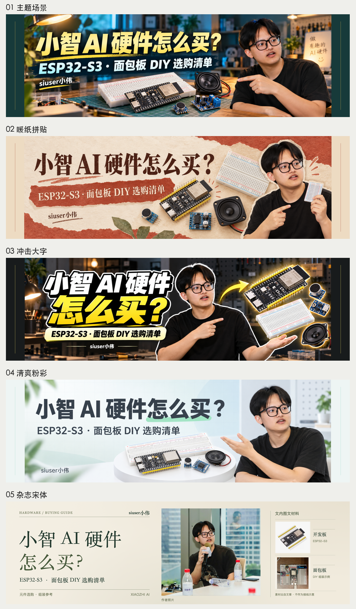

# 小智 AI 硬件选购：历史生成图与修正案例

[项目首页](../../../README.md) · [案例索引](../README.md) · [图片清单与校验值](manifest.json)

2026-10-14 的已有图片按字节归档，共 **10 个 PNG**：4 张工具原稿、5 张历史导出和1张总览。这些图产生于 v0.8 重构之前，不能作为新版十二个候选风格或自定义风格已通过生图验证的证据。

## 五张历史导出总览

## 工具原稿

以下原稿没有为上传补边、拉伸或重新生成。实际尺寸和SHA-256在manifest中；它们的实际比例约3:1，未达到本次目标3.35:1。

| 方向 | 未修改原稿 |
| --- | --- |
| 主题场景 | [01-series.png](originals/01-series.png) |
| 暖纸拼贴 | [02-baoyu.png](originals/02-baoyu.png) |
| 冲击大字 | [03-impact.png](originals/03-impact.png) |
| 清爽粉彩 | [04-oil.png](originals/04-oil.png) |

## 历史导出与失败边界

前四张3350×1000导出通过两侧补边得到，保留用于说明失败原因，**不通过新版独立原图验收**。第五张是独立HTML杂志稿，尺寸正确，但没有据此认定它满足新版内容、美学和身份验收。

| 方向 | 历史导出 | 状态 |
| --- | --- | --- |
| 主题场景 | [01-series](historical-exports/01-series-3.35x1.png) | 补边，拒绝 |
| 暖纸拼贴 | [02-baoyu](historical-exports/02-baoyu-3.35x1.png) | 补边，拒绝 |
| 冲击大字 | [03-impact](historical-exports/03-impact-3.35x1.png) | 补边，拒绝 |
| 清爽粉彩 | [04-oil](historical-exports/04-oil-3.35x1.png) | 补边，拒绝 |
| 杂志宋体 | [05-editorial](historical-exports/05-editorial-3.35x1.png) | 历史HTML稿，未经新版完整验收 |

这些图促成了新版的内容策划、构图碰撞、真实宽高和原稿来源门禁。主视觉、人物动作和布局仍须实际看图，不能用风格名称或尺寸通过代替美学判断。

## 公开范围与使用边界

作者授权在本仓库展示这些已有封面；人物肖像只限本仓库示例展示，不授予将其作为其它身份或图库素材复用的权利。硬件外观和场景用于封面说明，不是已验证电路、实测结果或产品规格证据。私有文章、私有链接、本机路径及完整私有生成记录未随本案例公开。
